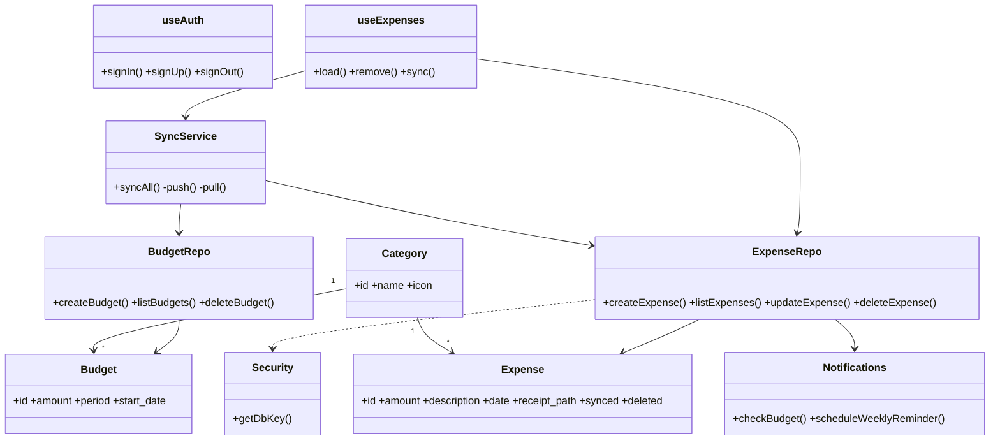
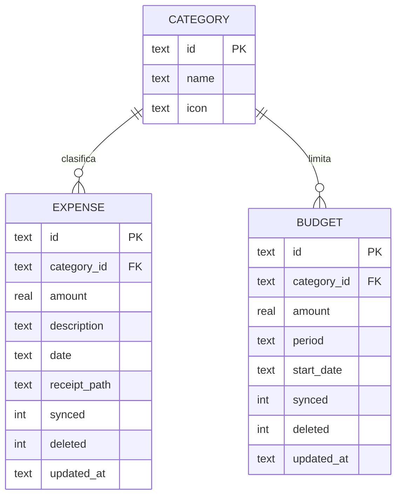

# Reporte técnico — Gastos MVP

## 1. Stack
React Native + Expo (SDK 52), TypeScript, expo-router, Supabase (Auth + Postgres), SQLite con SQLCipher.

## 2. Diagrama de clases / módulos

## 3. Modelo de datos

El DDL completo está en `src/data/schema.ts` (local) y `supabase/schema.sql` (nube). Se usa borrado lógico y `updated_at` para sincronizar.

## 4. Sincronización
Offline-first: toda escritura va a SQLite con `synced=0`. `syncAll()` envía (upsert) los pendientes y luego descarga cambios remotos con `updated_at` posterior a la última sincronización. Conflictos: *last-write-wins*. Estados `loading/success/error` en el store y la UI.

## 5. Seguridad
1. **Cifrado en reposo:** SQLCipher AES-256; clave de 256 bits generada con `expo-crypto` y guardada en Keychain/Keystore.
2. **Tokens:** sesión JWT cifrada con AES-CTR; la clave vive en SecureStore, el texto cifrado en AsyncStorage. Refresco automático por el SDK.
3. **Validación:** `zod` (monto positivo y acotado, texto ≤100, correo válido, contraseña ≥8), restricciones `CHECK` en SQLite/Postgres y consultas parametrizadas (sin concatenar input).
4. **Autorización en servidor:** Row Level Security; cada usuario solo accede a filas con `user_id = auth.uid()`.
5. **Biometría** al abrir la app y **cierre de sesión** que borra la BD local.
6. **Archivos:** fotos en el directorio privado; `.env` excluido de Git; sin `service_role` en el cliente.
7. **Limitaciones conocidas:** las fotos no están cifradas, y en dispositivos con root/jailbreak el Keystore puede quedar expuesto.

## 6. Notificaciones y hardware
Cámara (`expo-image-picker`), biometría (`expo-local-authentication`), notificación local al 80 % y recordatorio semanal (`expo-notifications`).

## 7. Librerías de terceros
zod, zustand, react-native-gifted-charts, aes-js.
